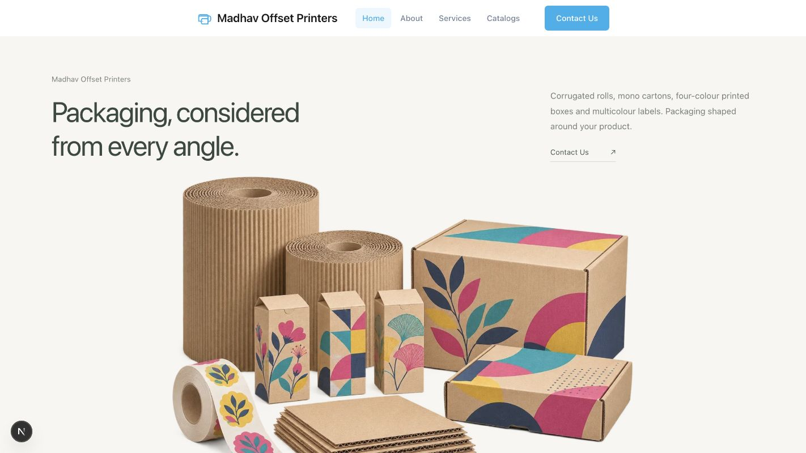
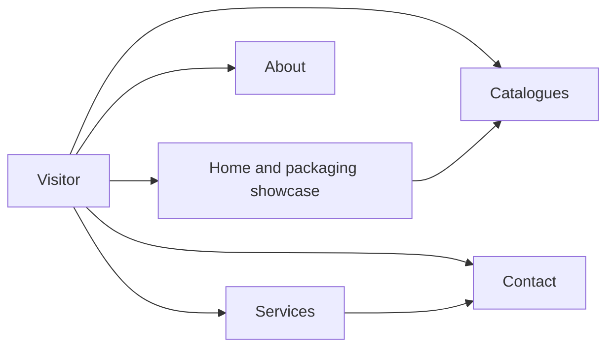

# Madhav Offset Printers

A Next.js website presenting Madhav Offset Printers' packaging products, services, company information and contact pages. The site combines product photography with animated, interactive packaging showcases.



## Explore

- Browse packaging applications and products on the home page.
- Explore company information, services, catalogues and contact pages.
- Find policy and accessibility information in the footer.

## Run locally

The application lives in the `madhav/` directory. Install its dependencies and start its development server:

```sh
cd madhav
npm ci
npm run dev
```

Open the local URL printed by Next.js. Use `npm run build` to create a production build and `npm run start` to serve it.

## Site structure



The website is implemented with Next.js, React, TypeScript, Three.js, GSAP and Framer Motion. Its sections and assets live under `madhav/src` and `madhav/public`.
